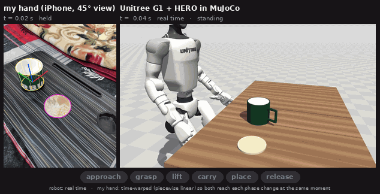
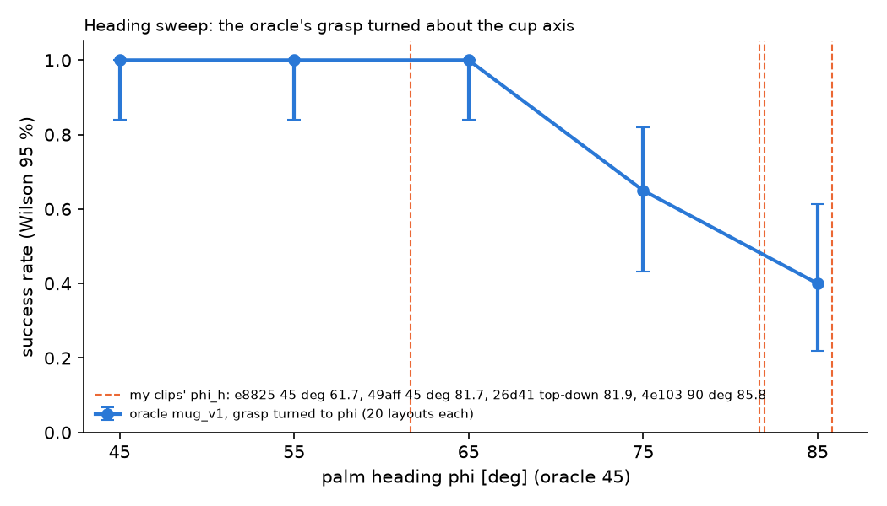
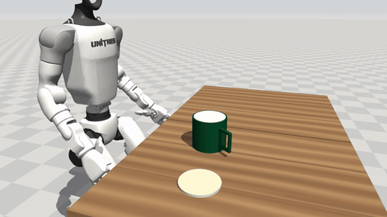
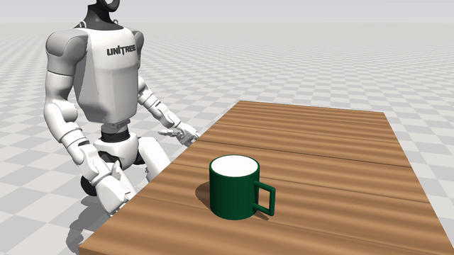

<!-- Draft of README.md. Every number links to the saved file it comes from. Links are relative to docs/: when this text
     replaces README.md, drop one "../" from every link and turn "log.md" / "INSTALL.md" into "docs/log.md" / "docs/INSTALL.md".
     Open slots are HTML comments tagged M5 (selector results), M6 (gallery) and M7 (reproduce script). -->

# teach-g1: a standing Unitree G1 learns my mug pick-and-place from four iPhone clips

I filmed my own right hand picking up my mug and putting it on a coaster, four times, with an iPhone's LiDAR camera. From those
clips the pipeline extracts a metric 3D hand path relative to the mug and the coaster, retargets it to a Unitree G1 humanoid that
stands and balances on its own legs (HERO whole-body controller, MuJoCo), and executes it on mug and coaster layouts that are not
the ones in my clips. Simulation only, no real robot. On [50](../results/m4b/summary.md) random layouts per clip, the variant that
keeps my palm heading, my approach up to the last [8 cm](log.md), my grasp height, my transport and my timing succeeds in
[112/200](../results/m4b/summary.md) runs (four clips x [50](../results/m4b/summary.md) layouts); the variant that also turns the grasp to the scripted
[45 deg](../results/m3_retarget/summary.md) heading succeeds in [179/200](../results/m4b/summary.md). A hand-scripted grasp with no
human data succeeds in [44/50](../results/m1_grasp_fix/v3_final/summary.md) on the same layouts. My first attempt, which followed my
whole approach, failed almost everywhere; [What worked and what didn't](#what-worked-and-what-didnt) says why.

**M5, the learned grasp selector.** A small network trained only on [120](../results/m5/train_layouts.json) training layouts
picks, per layout, which of my four clips to use and how far to turn the grasp away from my heading. Its "human-first" rule R2
succeeds on [49/50 (0.90-1.00)](../results/m5/summary.md) test layouts, and on [44/50 (0.76-0.94)](../results/m5/summary.md) when the robot's path is built from a
noisy layout. It keeps my own palm heading on [35/50](../results/m5/summary.md) layouts. The scripted grasp gets [44/50](../results/m5/summary.md) on the same layouts, but
R2's edge over it rests on [7](../results/m5/summary.md) layouts where only one of the two succeeds ([6](../results/m5/summary.md) vs [1](../results/m5/summary.md)), too few to call R2 better.



*Left: my [45 deg](../results/m2_perception_v3/summary.md) clip `e8825dea53` with the perception overlay (WiLoR hand skeleton, SAM 2
coaster outline). Right: the G1 in MuJoCo in real time, running the `b_hybrid` path built from that clip on evaluation layout
trial00 (a success, [21.9 s](../results/extra/hand_to_robot_phases.json) of simulated time). My clip is much faster (I release the
mug [5.55 s](../results/extra/hand_to_robot.json) into it, the robot opens its hand [18.18 s](../results/extra/hand_to_robot.json)
into its run), so my video is time-warped, piecewise linear, so that six events (approach start, contact, lift, carry, place,
release) happen at the same moment in both panels; during the approach it plays at [0.12x](../results/extra/hand_to_robot.json)
speed. The robot's last [8 cm](log.md) to the mug is the scripted straight move, not mine
([the fix](#4-the-fix-m4b-a-robot-specific-final-approach)), and the robot's mug sits where test layout trial00 puts it, not where
mine was.*

## What I recorded

- **Four clips of one task**, each a separate execution filmed from a different viewpoint: right-hand side wrap of my mug, place
  it on the coaster, release, hand out. I sat at the near long edge of a lap desk on a bed; the phone was propped by hand.
- **App:** [Stray Scanner](https://github.com/StrayRobots/scanner) on an iPhone with LiDAR. Each recording has RGB video
  ([1920x1440](../data/raw/sample/4e103843db/README.md)), LiDAR depth in millimetres ([256x192](../data/raw/sample/4e103843db/README.md)),
  depth confidence, per-frame intrinsics, camera poses (ARKit odometry) and the IMU.

| clip | view | optical axis from vertical | capture rate | length |
|---|---|---|---|---|
| `26d4118b0c` | top-down | [1 deg](../results/m2_views/table.md) | [30 Hz](../results/m2_views/table.md) | [8.30 s](../results/m2_perception/inventory.json) |
| `4e103843db` | [90 deg](../results/m2_perception_v3/summary.md): at my side, square to the desk edge | [37 deg](../results/m2_views/table.md) | [60 Hz](../results/m2_views/table.md), [19](../results/m2_views/table.md) dropped frames | [8.87 s](../results/m2_perception/inventory.json) |
| `49aff04f7a` | [45 deg](../results/m2_perception_v3/summary.md) (left / right not confirmed) | [31 deg](../results/m2_views/table.md) | [60 Hz](../results/m2_views/table.md) | [7.97 s](../results/m2_perception/inventory.json) |
| `e8825dea53` | [45 deg](../results/m2_perception_v3/summary.md) (left / right not confirmed) | [39 deg](../results/m2_views/table.md) | [60 Hz](../results/m2_views/table.md) | [7.89 s](../results/m2_perception/inventory.json) |

- **Objects** ([config/objects.yaml](../config/objects.yaml), the single source for perception and simulation; every value carries
  a source flag): glossy dark-green ceramic mug, [9.9 cm](../config/objects.yaml) wide and [9.1 cm](../config/objects.yaml) tall
  (base label), handle measured with a ruler, mass [0.40 kg](../config/objects.yaml) estimated (no scale); resin coaster about
  [10.4 cm](../config/objects.yaml) across (estimated); desk [60 x 38.5 cm](../config/objects.yaml) (measured).
- **Sample in the repo:** [data/raw/sample/4e103843db/](../data/raw/sample/4e103843db/README.md), the
  [90 deg](../results/m2_perception_v3/summary.md) clip, byte-identical to the original
  ([1032 files](../results/m5/data_sample_check.json), sha256 checked). Its README describes the format and the traps I found:
  `rgb.mp4` decodes to [513](../data/raw/sample/4e103843db/README.md) frames for [514](../data/raw/sample/4e103843db/README.md)
  depth / pose rows (the first frame is hidden by the MP4 edit list), the video clock is wrong (use the odometry timestamps), and
  the IMU is in g, not m/s^2. The four extracted demo files `data/demos/*.npz` are committed, so the simulation part runs without
  the raw clips.
- **Confound:** viewpoint and execution change together and [n = 4](../results/m2_perception_v3/summary.md), so no difference
  between clips can be blamed on the viewpoint.

## How it works

### 1. Perception: clip -> demo file (`perception/`, env `hoi-perception`, GPU)
- **Hand:** WiLoR finds my right hand in each frame and fits a MANO hand. Its depth is not metric (it comes from a near-orthographic
  crop camera), so each frame the hand is moved along its viewing ray to the median LiDAR depth under it, then slid parallel to the
  image so its palm projects onto WiLoR's own 2D palm keypoints (hand scale fixed at
  [1](../results/m2_perception_v3/summary.md)). Median LiDAR residual on the placed hand:
  [0.47-0.76 cm](../results/m2_perception_v3/summary.md) per clip.
- **Objects:** SAM 2.1 tracks masks of the mug body, the handle and the coaster from prompts I clicked on the first frame. The mug's
  label-size cylinder is fitted to the masks (the glossy mug's own depth is unreliable), the coaster gets a circle fit.
- **Table frame:** RANSAC plane through the LiDAR points; z up, origin at the mug's initial base centre, x = my forward direction
  (perpendicular to the desk's long edge, found in the depth image).
- **Events** from the metric palm path: contact (first frame within [1 cm](../results/m2_perception_v3/summary.md) of my closest
  approach to the mug axis before the palm starts to rise), lift, place, release.
- **Output:** one `data/demos/<clip>.npz` per clip (schema v4; field list in `perception/build_demo.py`) and per-clip gate reports
  in [results/m2_perception_v3/](../results/m2_perception_v3/summary.md).

### 2. Retargeting: my hand path -> a robot palm path (`retarget/`, env `hoi-sim`, kinematic)
- **Frames:** the table frame maps to the simulator with the same axes (x forward, y left, z up); the desk plane goes to the sim
  table top at [0.74 m](log.md), shifted per layout so the mug lands where the layout puts it.
- **Object-centric grasp:** the robot's grasp is built in the mug's frame: the mug axis at a fixed offset from the robot's palm,
  the palm turned to my palm heading at my grasp frame (phi_h, [61.7-85.8 deg](../results/m3_retarget/summary.md) across the clips;
  the scripted grasp uses [45 deg](../results/m3_retarget/summary.md)), at my grasp height as a fraction of the mug height.
- **Object-aware warps** (the idea is OKAMI's, CoRL 2024): my approach is bent with a smooth-step blend so it starts where the
  robot's hand is and ends at that grasp; my transport is bent from the grasp to the place pose above the coaster. Only the ends
  move; the shape in between is mine.
- **Timing:** my hand moves faster than the scripted grasp, so time is stretched by
  [k = max(1, my 95th-percentile palm speed / the scripted peak speed)](log.md), [1.09-1.74](../results/m3_retarget/summary.md) per
  clip; each segment is then re-timed to start and end at rest.
- **Variants:** `naive` = my palm path and wrist replayed at the recorded layout's fixed translation (it ignores where the test mug
  is); `b_level` = object-aware, my heading, level wrist; `b_tilt` = object-aware, my full wrist orientation.
- **Fingers:** my finger joint angles are **not** transferred. Per-digit IK closing targets were tried and made the grip worse
  ([0/20](../results/m1_grasp_fix/v3_final/summary.md), mean lift slip [47.06 mm](../results/m1_grasp_fix/v3_final/summary.md)); the
  Dex3 closes with HERO's demo grip until the fingertips touch.

### 3. Execution: HERO drives the standing G1 (`sim/`, env `hoi-sim`, CPU)
- **Whole-body control:** [HERO](https://github.com/RunpeiDong/HERO)'s example policy (ONNX, CPU) commands the G1's
  [29](log.md) body joints at [50 Hz](log.md); the robot balances on its own legs. HERO does not take a palm target, it tracks a
  reference motion clip. Our palm path becomes that clip through HERO's own whole-body IK (mink) and FK code; only HERO's
  straight-line path planner is replaced.
- **Settles:** between path segments, HERO's own closed-loop goal correction settles the palm at the pre-grasp, the grasp and the
  place pose. A settle that ends more than [3 cm](../sim/pick_place.py) from its target fails the run as "palm could not reach the
  target" ("reach").
- **Fingers and touch:** our own PD loop drives HERO's movable-finger Dex3 model; we added MuJoCo touch sensors on the fingertips.
  The hand closes until the thumb and one finger each read more than [0.3 N](../sim/pick_place.py), and the grip is checked again at
  the lift.
- **Mug grasp profile `mug_v1`:** the palm target is placed by the mug's radius (HERO's constant put the palm
  [11.65 mm](../results/m1_grasp_fix/b1_facts.md) inside my mug), plus MuJoCo's documented anti-slip settings for grasping (elliptic
  friction cones, impratio [10](../results/m1_grasp_fix/v3_final/summary.md), noslip_iterations
  [3](../results/m1_grasp_fix/v3_final/summary.md)). No friction coefficient, gain, torque limit, mug mass or geometry was changed.
- **Success** is read from the final simulator state: mug upright, on the coaster within [5 cm](../results/m4_execute/summary.md) of
  its centre, at rest on it, robot never fell.
- **Layouts:** [50](../results/m4_execute/summary.md) random mug / coaster layouts (trials 0-49), drawn so that the grasp palm and the
  nominal place palm lie inside the box the G1 was measured to reach, x [0.35-0.45 m](../sim/pick_place.py) and y
  [-0.32 to -0.12 m](../sim/pick_place.py) in front of it. Every variant runs the same layouts.
- **Oracle** (baseline, no human data): the scripted pick-and-place from M1 with HERO's side grasp, the `mug_v1` profile and exact
  simulator state.

### 4. The fix (M4b): a robot-specific final approach
`b_hybrid` is `b_level` with one change at the end of the approach: my approach is warped to end at a pre-grasp point
[8 cm](log.md) straight back from the grasp, the palm settles there, and the robot does the scripted straight
[2 s](log.md) move to the grasp. Everything from the close on is bit-identical to `b_level`. `b_hybrid_h45` is the same with the
grasp turned from my heading to the scripted [45 deg](../results/m3_retarget/summary.md).

### 5. The learned grasp selector (M5)
The original plan (ACT / Diffusion Policy in LeRobot) was replaced: M4b showed that my heading only transfers to this arm up to about
[65 deg](../results/m4b/summary.md), so the useful thing to learn is, per layout, which of my clips to use and how far to turn the
grasp away from my heading.
- **Candidates:** [18](../results/m5/rollout_items.json) (clip, heading) pairs: each clip at its own phi_h, plus
  [75, 65, 55 and 45 deg](../results/m5/rollout_items.json) where they lie below it (the
  [61.7 deg](../results/m3_retarget/summary.md) clip only gets [55 and 45](../results/m5/rollout_items.json)). The motion is always
  `b_hybrid` at that heading.
- **Training data:** [120](../results/m5/train_layouts.json) new random layouts, none within [1 mm](../results/m5/train_layouts.json)
  of a test mug or coaster; every candidate rolled out on every layout ([2160](../results/m5/rollout_items.json) simulator runs). The
  test layouts are never used for training, selection or thresholds.
- **Model:** an MLP [14 -> 64 -> 64 -> 1](../policy/train_selector.py) that predicts success from mug and coaster position, handle
  yaw, clip and heading; trained on [5](../policy/train_selector.py) noisy copies of each row (position noise
  [1 cm](../policy/features.py), yaw noise [10 deg](../policy/features.py)) in PyTorch, exported to ONNX and run with onnxruntime
  inside the simulation env.
- **Rules:** R1 = the candidate with the highest predicted success; R2 ("human first") = among the candidates with predicted success
  of at least [0.8](../policy/rules.py), the one closest to my heading (R1 if there is none); F = the single candidate with the best
  training success rate, used on every layout.
- **Test:** the selector always sees noisy inputs (the same noise, one draw per test layout). "Clean" runs build the robot's path
  from the true layout, "noisy" runs from the noisy one; the simulator always keeps the true positions.

**What the selector learned.**
- **Cross-validation:** grouped 5-fold cross-validation on the training layouts (noisy inputs) gives AUC [0.916](../results/m5/summary.md) and Brier
  [0.102](../results/m5/summary.md), so it predicts success well above chance.
- **Choosing per layout did not beat one fixed choice in cross-validation.** R1 picks a successful candidate on
  [115/120](../results/m5/summary.md) held-out layouts, the same as F ([115/120](../results/m5/summary.md)). R2 gets [109/120](../results/m5/summary.md) because it stays closer to my heading.
  At least one candidate succeeds on [120/120](../results/m5/summary.md).
- **On the test layouts R2 departs on average [3.4 deg](../results/m5/summary.md) from my heading** (max [36.7 deg](../results/m5/summary.md)).
  - It chose clip `e8825dea53`, whose heading is inside the arm's comfortable range, on [41](../results/m5/summary.md) layouts, and at its own heading
    on [33](../results/m5/summary.md).
  - Other clips at my heading: [2](../results/m5/summary.md).

## Results

Success on the same [50](../results/m4_execute/summary.md) test layouts. The "pool" column adds the four clips' runs; its Wilson
[95 %](../results/m4b/summary.md) interval treats the [200](../results/m4b/summary.md) runs as independent, but they reuse the same
layouts, so the real uncertainty is larger ([caveat 1](../results/m4_execute/summary.md)). Per-clip columns are out of
[50](../results/m4_execute/summary.md).

| variant (milestone) | what comes from my clips | pool (Wilson 95 %) | top-down | 90 deg | 45 deg `49aff` | 45 deg `e8825` |
|---|---|---|---|---|---|---|
| (a) `naive` replay (M4) | whole palm path and wrist, fixed place; closure timing | [0/200 (0.000-0.019)](../results/m4_execute/summary.md) | [0](../results/m4_execute/summary.md) | [0](../results/m4_execute/summary.md) | [0](../results/m4_execute/summary.md) | [0](../results/m4_execute/summary.md) |
| `b_level` (M4) | approach + transport (warped), heading, grasp height, timing | [23/200 (0.078-0.167)](../results/m4_execute/summary.md) | [0](../results/m4_execute/summary.md) | [0](../results/m4_execute/summary.md) | [0](../results/m4_execute/summary.md) | [23](../results/m4_execute/summary.md) |
| `b_tilt` (M4) | as `b_level` plus my wrist tilt | [39/200 (0.146-0.255)](../results/m4_execute/summary.md) | [4](../results/m4_execute/summary.md) | [0](../results/m4_execute/summary.md) | [18](../results/m4_execute/summary.md) | [17](../results/m4_execute/summary.md) |
| (b) `b_hybrid` (M4b) | as `b_level` minus my last [8 cm](log.md) of approach | [112/200 (0.49-0.63)](../results/m4b/summary.md) | [22](../results/m4b/summary.md) | [14](../results/m4b/summary.md) | [27](../results/m4b/summary.md) | [49](../results/m4b/summary.md) |
| `b_hybrid_h45` (M4b) | as `b_hybrid` minus my heading | [179/200 (0.84-0.93)](../results/m4b/summary.md) | [43](../results/m4b/summary.md) | [46](../results/m4b/summary.md) | [46](../results/m4b/summary.md) | [44](../results/m4b/summary.md) |
| scripted oracle | nothing | [44/50 (0.762-0.944)](../results/m1_grasp_fix/v3_final/summary.md) | | | | |
| (c) selector R1 (M5), clean | heading candidate + clip; approach, height, transport | [47/50 (0.84-0.98)](../results/m5/summary.md) | chosen [24](../results/m5/summary.md) | chosen [8](../results/m5/summary.md) | chosen [7](../results/m5/summary.md) | chosen [11](../results/m5/summary.md) |
| (c) selector R2 human-first (M5), clean | as R1, preferring my heading | [49/50 (0.90-1.00)](../results/m5/summary.md) | [5](../results/m5/summary.md) | [0](../results/m5/summary.md) | [4](../results/m5/summary.md) | [41](../results/m5/summary.md) |
| fixed-best candidate F (M5), clean | one candidate (`4e103843db` at 45 deg) | [46/50 (0.81-0.97)](../results/m5/summary.md) | | [50](../results/m5/summary.md) | | |
| R2, noisy path (M5) | as R2 | [44/50 (0.76-0.94)](../results/m5/summary.md) | | | | |
| F = `b_hybrid_h45` `4e103843db`, noisy path (M5) | as F | [38/50 (0.63-0.86)](../results/m5/summary.md) | | | | |
| `b_hybrid` at each layout's own handle yaw (M5) | as `b_hybrid` | [98/200 (0.42-0.56)](../results/m5/summary.md) | [22](../results/m5/summary.md) | [11](../results/m5/summary.md) | [21](../results/m5/summary.md) | [44](../results/m5/summary.md) |

The M5 rows use one handle yaw per layout, the layout's own. M4b's `b_hybrid` row turned the handle with the grasp, which is why it
differs ([112](../results/m4b/summary.md) vs [98](../results/m5/summary.md)).


*The table as success rates with Wilson 95 % intervals ([results/final/figures.json](../results/final/figures.json),
[retarget/final_figures.py](../retarget/final_figures.py)). Green = the learned selector; the dashed line is the scripted oracle.*

On the recorded layout (mug and coaster placed with my own coaster offset), `b_level` succeeded for
[1 of 4](../results/m4_execute/summary.md) clips (`e8825dea53`, mug [0.81 cm](../results/m4_execute/summary.md) from the coaster
centre).

**Heading sweep.** The scripted grasp (no human data) turned about the mug axis, [20](../results/m4b/summary.md) layouts per heading:
[20/20](../results/m4b/summary.md) at [45, 55 and 65 deg](../results/m4b/summary.md), [13/20](../results/m4b/summary.md) at
[75 deg](../results/m4b/summary.md), [8/20](../results/m4b/summary.md) at [85 deg](../results/m4b/summary.md). The dashed lines are
my four palm headings, [61.7, 81.7, 81.9 and 85.8 deg](../results/m3_retarget/summary.md).




*The same sweep with R2's choices on the test layouts: one marker per clip and heading, at the success rate of those runs, sized by
how often R2 chose it ([results/final/figures.json](../results/final/figures.json)). R2 mostly stays at or below
[65 deg](../results/m4b/summary.md), where the sweep is flat at 20/20.*

## What worked and what didn't

### Perception
- **Worked.** LiDAR places the hand to [0.47-0.76 cm](../results/m2_perception_v3/summary.md) (median residual). All four clips have
  contact, lift, place and release in order. As a check of the object positions, my final mug position lies
  [0.54-2.15 cm](../results/m2_perception_v3/summary.md) from the coaster centre. The table frame's x axis is within
  [1.3-15.7 deg](../results/m2_perception_v3/summary.md) of the expected direction.
- **Mug fit fails on every clip** (gate G6): the fitted diameter is [105.1-106.1 mm](../results/m2_perception_v3/summary.md) against
  the [99 mm](../results/m2_perception_v3/summary.md) label, the same bias in every view. Full-resolution SAM 2 masks did not remove
  it ([v2 test](../results/m2_perception_v2/summary.md)); the cause is not found. The simulator uses the label geometry.
- **Hand reprojection** (G3, now information only): the placed palm lands [14.17-51.72 px](../results/m2_perception_v3/summary.md)
  from WiLoR's own 2D palm keypoints. WiLoR's 3D hand matches its 2D keypoints only under its near-orthographic crop camera, not
  under the phone's real perspective camera at [35-45 cm](../results/m2_perception_v3/summary.md).
- **Negative result, dropped:** a per-clip hand-scale fit (v2) gave scales from [0.847 to 1.154](../results/m2_perception_v3/summary.md)
  depending on the view. It absorbed that camera mismatch instead of measuring my hand, so the scale is now fixed at
  [1](../results/m2_perception_v3/summary.md).
- **Fixed along the way:** v1 lost every event on the top-down clip, because a contact threshold set before seeing data
  ([0.100 m](../results/m2_perception/26d4118b0c/stages/events.json) from the mug axis) was never reached (closest approach
  [0.102 m](../results/m2_perception/26d4118b0c/stages/events.json)); contact is now relative to each clip's own closest approach.
  v1's desk-edge rule counted gaps between line fragments as length and turned the `49aff04f7a` table frame by
  [23.9 deg](../results/m2_perception/summary.md).
- **Still weak:** on `e8825dea53` the handle is hidden at the start, so its handle direction is invalid; the static-jitter gate is
  N/A on both [45 deg](../results/m2_perception_v3/summary.md) clips (no [0.3 s](../results/m2_perception_v3/summary.md) hold).

### Grasping my mug (before any human data)
The M1 scripted grasp worked on a test cylinder ([50/50](../results/m1_pick_mug/table.md)) and failed on my mug's model
([0/50](../results/m1_pick_mug/table.md): slips in the lift and drops in transport). Size alone took it from
[20/20 to 5/20](../results/m1_grasp_fix/b3_causes.md), the mass to [0/20](../results/m1_grasp_fix/b3_causes.md). Radius-consistent
palm target: [0/20](../results/m1_grasp_fix/v3_final/summary.md); plus IK finger targets: [0/20](../results/m1_grasp_fix/v3_final/summary.md);
plus the anti-slip contact settings: [11/20](../results/m1_grasp_fix/v3_final/summary.md). The palm target and the contact settings
with HERO's own finger targets (`mug_v1`): [20/20](../results/m1_grasp_fix/v3_final/summary.md), then
[44/50](../results/m1_grasp_fix/v3_final/summary.md) on the test layouts ([5](../results/m1_grasp_fix/v3_final/summary.md) approach
knocks, [1](../results/m1_grasp_fix/v3_final/summary.md) low lift). These are runs in different configurations, not an ablation: how
much comes from the palm target and how much from the contact model was not tested.

### M4: following my whole approach failed
`b_level` [23/200](../results/m4_execute/summary.md), `b_tilt` [39/200](../results/m4_execute/summary.md), `naive`
[0/200](../results/m4_execute/summary.md), against the oracle's [44/50](../results/m4_execute/summary.md). `b_level` worked only on
`e8825dea53` ([23/50](../results/m4_execute/summary.md)), the clip with the lowest heading. Diagnosed from the saved runs, with no new
simulation:
- **The open fingers sweep through the mug.** The Dex3 fingertips sit about [8 cm](../results/m3_retarget/palm_axes.json) in front of
  the palm point HERO tracks. Following my last centimetres of approach drives them through the mug: on the planned approach the
  hand overlaps the mug in all [177](../results/m4b/summary.md) failed `b_level` runs (median deepest overlap
  [37.2 mm](../results/m4b/summary.md)), while the scripted straight approach clears it (median
  [5.6 mm](../results/m4_execute/summary.md), [0 of 10](../results/m4_execute/summary.md) overlapping). This is a kinematic
  diagnostic, not a physics measurement.
- **The failure label hid it.** The executor settles the palm at the grasp before it checks whether the mug moved (the oracle's
  order), so a pushed mug whose palm then ends more than [3 cm](../sim/pick_place.py) from the target is filed as "reach". Re-filed by
  the mug's final position, [132 of 177](../results/m4b/summary.md) `b_level` failures had pushed the mug more than
  [2 cm](../results/m4b/summary.md) before the close.
- **The grasp itself was fine.** No `b` run failed with a slip in the lift; [2](../results/m4_execute/summary.md) dropped the mug in
  transport.
- `naive` fails by construction (it replays at the recorded place, wherever the test mug is). And the kinematic check of M3 did not
  predict physics: `b_tilt` was reachable on [0/44](../results/m3_retarget/summary.md) planned paths yet succeeded in
  [39/200](../results/m4_execute/summary.md) runs.

### M4b: what the fix changed, and what is only suggested
- **Tested:** the robot-specific approach helps at my heading, [23/200 -> 112/200](../results/m4b/summary.md); on the same layouts
  `b_hybrid` wins [89](log.md) layouts against `b_level` ([22 + 14 + 27 + 26](../results/m4b/summary.md) per clip) and loses
  [0](../results/m4b/summary.md). It bundles three changes (where the pre-grasp settle happens, a longer warped approach, the straight
  final leg); which of them matters is not separated.
- **Tested:** turning the grasp to [45 deg](../results/m3_retarget/summary.md) on top helps,
  [112/200 -> 179/200](../results/m4b/summary.md). The whole gain is on the three clips with headings of
  [81.7-85.8 deg](../results/m3_retarget/summary.md) (layouts won only by `b_hybrid_h45`: [22, 32, 21](../results/m4b/summary.md);
  only by `b_hybrid`: [1, 0, 2](../results/m4b/summary.md)). On `e8825dea53` ([61.7 deg](../results/m3_retarget/summary.md)) keeping
  my heading is better: [49/50](../results/m4b/summary.md) against [44/50](../results/m4b/summary.md), and against the oracle
  [5](../results/m4b/summary.md) layouts won, [0](../results/m4b/summary.md) lost.
- **Not tested: which factor is larger.** The steps are sequential (`b_level` -> `b_hybrid` -> `b_hybrid_h45`), not factorial; there
  is no "`b_level` at [45 deg](../results/m3_retarget/summary.md)" arm.
- **Tested on the scripted oracle alone:** success falls between [65 and 75 deg](../results/m4b/summary.md)
  ([20/20 -> 13/20](../results/m4b/summary.md)).
- **Only suggested: why high headings fail.** Most `b_hybrid` reach failures give up at the pre-grasp
  ([49](../results/m4b/summary.md)) or place ([20](../results/m4b/summary.md)) settle, as at [85 deg](../results/m4b/summary.md) in
  the sweep (pre-grasp [5](../results/m4b/summary.md), place [3](../results/m4b/summary.md)). All [49](../results/m4b/summary.md)
  pre-grasp failures overlap the mug on the way to the pre-grasp point (median [-36.9 mm](../results/m4b/summary.md)), against
  [0 of 179](../results/m4b/summary.md) `b_hybrid_h45` successes; yet the log notes that none of them pushed the mug more than
  [2 cm](log.md), and in M4 the [81.7 deg](../results/m3_retarget/summary.md) clip had [0](../results/m4_execute/summary.md)
  pre-grasp failures. Arm reach and contact on the way in are both possible causes; they are not separated.
- **What my data still does.** Both hybrids drop my final ~[8 cm](log.md) of approach. `b_hybrid_h45` also drops my heading; it keeps
  my approach shape up to the pre-grasp point, my grasp height, my transport and my timing. `b_hybrid` keeps my heading too, and it
  matches or beats the oracle only on the clip whose heading lies inside the range where the sweep stays at
  [20/20](../results/m4b/summary.md).

### M5: the learned selector
- **Worked.** R2 reached [49/50](../results/m5/summary.md) on the test layouts while using my heading on [35/50](../results/m5/summary.md). Paired with F (always
  `4e103843db` at 45 deg): both succeed on [45](../results/m5/summary.md), only R2 on [4](../results/m5/summary.md), only F on [1](../results/m5/summary.md).
- **Robustness.** With the path built from a layout perturbed by 1 cm / 10 deg noise, R2 dropped to [44/50](../results/m5/summary.md) and F to
  [38/50](../results/m5/summary.md). The failures added are mostly "pushed mug before close" ([summary](../results/m5/summary.md)).
- **Didn't.** In cross-validation, learning did not beat the fixed best choice (R1 [115](../results/m5/summary.md) = F [115](../results/m5/summary.md) of 120: branch D2).
  The test gain of R1 over F is small ([47](../results/m5/summary.md) vs [46](../results/m5/summary.md)).
- **Honest reading.** Most of R2's success comes from choosing the clip whose own heading the arm can execute (`e8825dea53`,
  [41/50](../results/m5/summary.md) layouts), not from learning a fine-grained heading per layout. For the other clips, turning the grasp toward 45 deg
  does the work ([candidates](../results/m5/candidates.md)).
- **Confounds.**
  - The test layouts were also used in M4 / M4b (to compare variants), but never to train or select here.
  - The place correction reads privileged simulator state ([summary](../results/m5/summary.md)).

## How to run

Install steps, weights, MANO and licences are in [INSTALL.md](INSTALL.md). Two conda envs exchange only files: `hoi-perception`
(WiLoR, SAM 2, GPU) and `hoi-sim` (HERO, MuJoCo, CPU). The committed demo files mean the simulation runs without perception.
Always clear `PYTHONPATH` (a ROS install on my machine leaks into every env). Batch commands refuse to overwrite saved results
without `--overwrite`, so the examples write to `/tmp`:

```bash
P="env -u PYTHONPATH conda run --no-capture-output -n hoi-perception python"
S="env -u PYTHONPATH conda run --no-capture-output -n hoi-sim python"

$P -m perception.run_clip                          # all stages, all 4 raw clips in data/raw/<id>/ -> data/demos/*.npz
$S -m retarget.run_m3 verify                       # M3 checks (rewrites results/m3_retarget/verify.json), then: run, summarize
$S -m retarget.run_m3_v2 paths                     # re-timed v2 paths (refuses over the saved ones without --overwrite)
$S -m sim.m1_grasp_final run --step run1 --out /tmp/teach_g1/oracle      # scripted oracle, mug_v1 (then --step fifty)
$S -m sim.m4_execute run --workers 8 --out /tmp/teach_g1/m4              # M4: naive, b_level, b_tilt x 4 clips x 50 layouts
$S -m sim.m4_execute run --variants b_hybrid b_hybrid_h45 --workers 8 --out /tmp/teach_g1/m4b    # M4b
$S -m sim.m4b_heading_sweep --out /tmp/teach_g1/sweep                    # oracle grasp turned to 45..85 deg
$S -m retarget.m4_summary                          # results/m4_execute/summary.md from the saved rows (simulates nothing)
$S -m retarget.m4b_summary summarize               # results/m4b/summary.md + heading_sweep.png from the saved rows
$S -m sim.m4_execute rerun --row results/m4b/runs/e8825dea53__b_hybrid__trial00.json --report /tmp/rerun.json  # one row, compared field by field
```

Videos need offscreen EGL: prefix the video commands with `MUJOCO_GL=egl` and an EGL vendor file (see [INSTALL.md](INSTALL.md)).
The M4 batch ([600](../results/m4_execute/run_resources_20261031_022916.json) runs) took
[823.6 s](../results/m4_execute/run_resources_20261031_022916.json) on [8](../results/m4_execute/run_resources_20261031_022916.json)
CPU worker processes. Re-runs match the saved rows: the oracle's trials 0-4 re-run identical in every field but wall time
([5 of 5](../results/m4_execute/determinism_checks.json)), and so does every re-rendered video run
([M4b](../results/m4b/summary.md)).

<!-- M7: reproduce.sh: one line on scripts/reproduce.sh (re-runs one oracle trial, one b_hybrid_h45 trial and one R2 trial from
     committed files and regenerates the M4 / M4b / M5 summaries; exits non-zero if anything differs), with its runtime -->

## Limitations

- **Simulation only.** No real robot. The mug's mass and the coaster size are estimates, and the anti-slip contact settings
  (impratio [10](../results/m1_grasp_fix/v3_final/summary.md)) come from MuJoCo Menagerie's hand models, not from a measurement of my
  mug.
- **Privileged place correction.** For the oracle and every `b` variant, the place pose is corrected with the mug's true pose in the
  hand, read from the simulator at the top of the transport. Perception does not provide this. The robot also gets the exact mug and
  coaster positions; only M5's noisy runs perturb them ([1 cm](../policy/features.py), [10 deg](../policy/features.py)).
- **Small workspace.** Layouts keep the palm inside x [0.35-0.45 m](../sim/pick_place.py), y [-0.32 to -0.12 m](../sim/pick_place.py).
  In a wider box (x [0.28-0.55 m](../results/m1_pick_stress/pick_results.json), y
  [-0.45 to -0.02 m](../results/m1_pick_stress/pick_results.json)) even the M1 scripted grasp on the easy cylinder succeeded in only
  [12/20](../results/m1_pick_stress/pick_results.json).
- **Layout reuse.** The same [50](../results/m4_execute/summary.md) test layouts are used in M4, M4b and M5, and the M4b fix was
  designed after looking at M4's failures on them. M5 trains on [120](../results/m5/train_layouts.json) disjoint layouts and keeps the
  test layouts for testing only. The four clips run the same layouts, so pooled intervals are too narrow.
- **[n = 4](../results/m2_perception_v3/summary.md) clips**, with viewpoint and execution confounded: the "how does the viewpoint
  matter" question cannot be answered from this data. The clip that did best in M4 (`e8825dea53`) is also the one whose heading is
  closest to the robot's comfortable range.
- **What my data controls is limited.** No finger angles; in the best variants not my final approach; in `b_hybrid_h45` not my
  heading. The heading limit was measured on the scripted grasp, not on my paths.
- **Perception gates:** the mug fit (G6) fails on all clips and the hand reprojection (G3) is
  [14.17-51.72 px](../results/m2_perception_v3/summary.md); the `49aff04f7a` table frame is
  [15.7 deg](../results/m2_perception_v3/summary.md) off. Running perception needs all four raw clips; only one is committed.
- **Licences.** WiLoR's models are CC BY-NC-ND and MANO is non-commercial, so the perception half cannot be used commercially.
- HERO's object inputs are fed zeros (a mug on a table is outside what they were trained on), and HERO's example policy is used as
  shipped; we do not train it.

## Third-party code

Cloned into `third_party/` (gitignored); nothing is redistributed or modified in this repo. Commits from
`git -C third_party/<repo> rev-parse --short HEAD`, the same as recorded in [log.md](log.md).

| repo | commit | licence (file checked) | used for |
|---|---|---|---|
| [RunpeiDong/HERO](https://github.com/RunpeiDong/HERO) | `416c4e0` | MIT (`LICENSE`) | whole-body policy, G1 + Dex3 model, IK / FK code |
| [rolpotamias/WiLoR](https://github.com/rolpotamias/WiLoR) | `fcb9113` | CC BY-NC-ND 4.0, code and models (`license.txt`) | 3D hand per frame |
| [MANO](https://mano.is.tue.mpg.de) (download after registration) | - | non-commercial ([licence](https://mano.is.tue.mpg.de/license.html)) | hand model inside WiLoR |
| [facebookresearch/sam2](https://github.com/facebookresearch/sam2) | `2b90b9f` | Apache-2.0 (`LICENSE`; its optional CUDA connected-components code is BSD-3, `LICENSE_cctorch`, not built here) | mug, handle and coaster masks |
| [StrayRobots/scanner](https://github.com/StrayRobots/scanner) | `ec3e1dc` | MIT (`LICENSE.md`) | the recording app; its `docs/format.md` for the parser |

Python packages (pins in `envs/`): MuJoCo (Apache-2.0), mink (Apache-2.0), onnxruntime (MIT), and ultralytics (AGPL-3.0), which
WiLoR's hand detector runs on. Ideas: object-aware retargeting from OKAMI (CoRL 2024).

## Gallery

| | |
|---|---|
|  |  |
| **The learned selector (R2)** on test layout trial00: it picked `e8825dea53` at 55 deg ([videos.json](../results/m5/videos/videos.json)) | **`b_hybrid`**: my heading and approach, the robot's final 8 cm, my transport (`e8825dea53`, trial00) |
|  |  |
| **Scripted oracle** (no human data), trial 0 ([videos.json](../results/final/videos/oracle/videos/videos.json)) | **M4 `b_level` failure**: following my whole approach, the open fingers push the mug away before the grasp ([videos.json](../results/final/videos/b_level_failure/videos.json)) |

Every GIF is a re-run of a saved row, checked identical to it before rendering. Other committed GIFs:
[M4 `b_level` success](../results/m4_execute/b_level_success.gif) and the
[M3 kinematic replay](../results/m3_retarget/4e103843db__b_level__recorded.gif).
