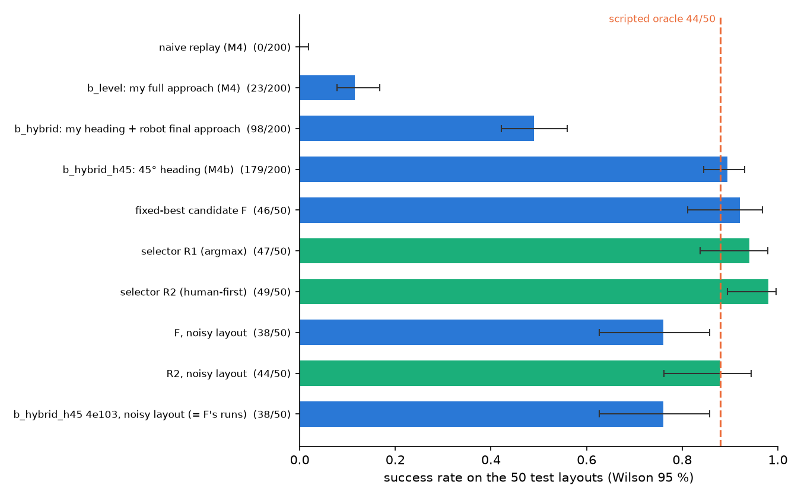
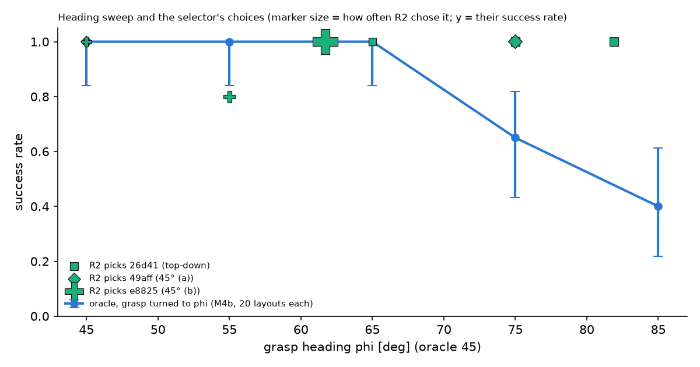

# teach-g1: details

The [README](../README.md) is the short version. This page has the rest: how each part works, every result table (including the
turned-handle runs of M4 and M4b), what worked and what didn't, and the full run commands. Each paragraph or table names its source
file once. [log.md](log.md) is the running record of every step, including what broke.

## The handle-yaw convention

Each test layout (trials 0-49) fixes the mug position, the coaster position and the direction of the mug's handle (its yaw). M4 ran
`naive`, `b_level` and `b_tilt`, and M4b ran `b_hybrid`, with the handle turned along with my grasp heading: handle yaw = layout
yaw + (phi_h - 45 deg), a turn of 36.9, 40.8, 36.7 and 16.7 deg for `26d4118b0c`, `4e103843db`, `49aff04f7a` and `e8825dea53`.
The scripted oracle, `b_hybrid_h45` and every M5 run use the layout's own yaw. The palm paths do not read the handle yaw, so the
only difference is where the handle points in the scene.

For one consistent table, `naive`, `b_level` and `b_tilt` were re-run at each layout's own yaw, and `b_hybrid` at the own yaw comes
from M5. The README uses only these own-yaw numbers. The turned-handle numbers (M4: `naive` 0/200, `b_level` 23/200, `b_tilt`
39/200; M4b: `b_hybrid` 112/200) are what those runs measured; below they are marked "turned handle". Three more places use the
turned handle: the heading sweep (the whole scripted grasp, handle included, turned to each heading), the `b_hybrid` GIFs (M4b
runs), and the M5 summary's `naive` and `b_level` rows (copied from M4, so `b_level` shows 23/200 there, not 25/200). Sources:
[own-yaw summary](../results/final/own_yaw/summary.md), [M4 summary](../results/m4_execute/summary.md),
[M4b summary](../results/m4b/summary.md), [M5 summary](../results/m5/summary.md).

## What I recorded

- **Four clips of one task**, each a separate execution filmed from a different viewpoint: right-hand side wrap of my mug, place
  it on the coaster, release, hand out. I sat at the near long edge of a lap desk on a bed; the phone was propped by hand.
- **App:** [Stray Scanner](https://github.com/StrayRobots/scanner) on an iPhone with LiDAR. Each recording has RGB video
  (1920x1440), LiDAR depth in millimetres (256x192), depth confidence, per-frame intrinsics, camera poses (ARKit odometry) and the
  IMU. All four clips are committed, unchanged, in `data/raw/<id>/`; [data/raw/README.md](../data/raw/README.md) describes the
  format and the traps I found (the video decodes to one frame fewer than the depth / pose rows, its clock is wrong, the IMU is in g).
  The four extracted demo files `data/demos/*.npz` are committed too, so the simulation part runs without perception.

| clip | view | optical axis from vertical | capture rate | length |
|---|---|---|---|---|
| `26d4118b0c` | top-down | 1 deg | 30 Hz | 8.30 s |
| `4e103843db` | 90 deg: at my side, square to the desk edge | 37 deg | 60 Hz, 19 dropped frames | 8.87 s |
| `49aff04f7a` | 45 deg (left / right not confirmed) | 31 deg | 60 Hz | 7.97 s |
| `e8825dea53` | 45 deg (left / right not confirmed) | 39 deg | 60 Hz | 7.89 s |

Sources: [results/m2_views/table.md](../results/m2_views/table.md) (axis, rate, dropped frames) and
[results/m2_perception/inventory.json](../results/m2_perception/inventory.json) (length).

- **Objects** ([config/objects.yaml](../config/objects.yaml), the single source for perception and simulation; every value carries
  a source flag): glossy dark-green ceramic mug, 9.9 cm wide and 9.1 cm tall (base label), handle measured with a ruler, mass
  0.40 kg estimated (no scale); resin coaster about 10.4 cm across (estimated); desk 60 x 38.5 cm (measured).
- **Confound:** viewpoint and execution change together and n = 4, so no difference between clips can be blamed on the viewpoint.

## How it works

### 1. Perception: clip -> demo file (`perception/`, env `hoi-perception`, GPU)
- **Hand:** WiLoR finds my right hand in each frame and fits a MANO hand. Its depth is not metric (it comes from a near-orthographic
  crop camera), so each frame the hand is moved along its viewing ray to the median LiDAR depth under it, then slid parallel to the
  image so its palm projects onto WiLoR's own 2D palm keypoints (hand scale fixed at 1). Median LiDAR residual on the placed hand:
  0.47-0.76 cm per clip.
- **Objects:** SAM 2.1 tracks masks of the mug body, the handle and the coaster from first-frame prompts (an HSV colour rule plus
  boxes set by hand, every first mask checked by eye; `perception/prompts/`). The mug's
  label-size cylinder is fitted to the masks (the glossy mug's own depth is unreliable); the coaster gets a circle fit.
- **Table frame:** RANSAC plane through the LiDAR points; z up, origin at the mug's initial base centre, x = my forward direction
  (perpendicular to the desk's long edge, found in the depth image).
- **Events** from the metric palm path: contact (first frame within 1 cm of my closest approach to the mug axis before the palm
  starts to rise), lift, place, release.
- **Output:** one `data/demos/<clip>.npz` per clip (schema v4; field list in `perception/build_demo.py`) and per-clip gate reports.

Source: [results/m2_perception_v3/summary.md](../results/m2_perception_v3/summary.md).

### 2. Retargeting: my hand path -> a robot palm path (`retarget/`, env `hoi-sim`, kinematic)
- **Frames:** the table frame maps to the simulator with the same axes (x forward, y left, z up); the desk plane goes to the sim
  table top at 0.74 m, shifted per layout so the mug lands where the layout puts it.
- **Object-centric grasp:** the robot's grasp is built in the mug's frame: the mug axis at a fixed offset from the robot's palm,
  the palm turned to my palm heading at my grasp frame (phi_h, 61.7-85.8 deg across the clips; the scripted grasp uses 45 deg), at
  my grasp height as a fraction of the mug height.
- **Object-aware warps** (the idea is OKAMI's, CoRL 2024): my approach is bent so it starts where the robot's hand is and ends at
  that grasp. Every frame gets (1 - w) x the start offset + w x the end offset, with w a min-jerk blend from 0 to 1 over the
  approach, so every frame moves, not only the ends; then the palm is kept at least 3 cm above the table. My transport is bent the
  same way (with a linear blend) from the grasp to the place pose above the coaster, and its rise above the straight grasp-to-place
  line is scaled down to at most 10 cm. In both, the palm orientation is held at the grasp orientation, so my wrist rotation is not
  used (except in `b_tilt`).
- **Timing:** my hand moves faster than the scripted grasp, so time is stretched by k = max(1, my 95th-percentile palm speed / the
  scripted peak speed), 1.09-1.74 per clip; each segment is then re-timed to start and end at rest.
- **Variants:** `naive` = my palm path and wrist replayed at the recorded layout's fixed translation (it ignores where the test mug
  is); `b_level` = object-aware, my heading, level wrist; `b_tilt` = object-aware, my full wrist orientation.
- **Fingers:** my finger joint angles are **not** transferred. Per-digit IK closing targets were tried and made the grip worse; the
  Dex3 closes with HERO's own closing targets until the fingertips touch.

Source: [results/m3_retarget/summary.md](../results/m3_retarget/summary.md); the warp limits are in `retarget/warp.py`.

### 3. Execution: HERO drives the standing G1 (`sim/`, env `hoi-sim`, CPU)
- **Whole-body control:** [HERO](https://github.com/RunpeiDong/HERO)'s example policy (ONNX, CPU) commands the G1's 29 body joints
  at 50 Hz; the robot balances on its own legs. HERO does not take a palm target, it tracks a reference motion clip. Our palm path
  becomes that clip through HERO's own whole-body IK (mink) and FK code; only HERO's straight-line path planner is replaced.
- **Settles:** between path segments, HERO's own closed-loop goal correction settles the palm at the pre-grasp, the grasp and the
  place pose. A settle that ends more than 3 cm from its target fails the run as "palm could not reach the target" ("reach").
- **Fingers and touch:** our own PD loop drives HERO's movable-finger Dex3 model; we added MuJoCo touch sensors on the fingertips.
  The hand closes until the thumb and one finger each read more than 0.3 N, and the grip is checked again at the lift.
- **Mug grasp profile `mug_v1`:** the palm target is placed by the mug's radius (HERO's constant put the palm 11.65 mm inside my
  mug), plus MuJoCo's anti-slip settings for grasping (elliptic friction cones, impratio 10 as in MuJoCo Menagerie's hand models,
  noslip_iterations 3). No
  friction coefficient, gain, torque limit, mug mass or geometry was changed.
- **Success** is read from the final simulator state: mug upright, on the coaster within 5 cm of its centre, at rest on it, robot
  never fell.
- **Layouts:** 50 random mug / coaster layouts (trials 0-49), drawn so that the grasp palm and the nominal place palm lie inside the
  box the G1 was measured to reach, x 0.35-0.45 m and y -0.32 to -0.12 m in front of it. Every variant runs the same layouts.
- **Oracle** (baseline, no human data): the scripted pick-and-place from M1 with HERO's side grasp, the `mug_v1` profile and exact
  simulator state.

Sources: `sim/pick_place.py` (thresholds, palm box), [results/m1_grasp_fix/b1_facts.md](../results/m1_grasp_fix/b1_facts.md) and
[results/m1_grasp_fix/v3_final/summary.md](../results/m1_grasp_fix/v3_final/summary.md) (the profile).

### 4. The fix (M4b): a robot-specific final approach
`b_hybrid` is `b_level` with one change at the end of the approach: my approach is warped to end at a pre-grasp point 8 cm straight
back from the grasp, the palm settles there, and the robot does the scripted straight 2 s move to the grasp. The planned path from
the close on is bit-identical to `b_level`'s. `b_hybrid_h45` is the same with the grasp turned from my heading to the scripted 45 deg.
(Details: [log.md](log.md), section M4b.)

### 5. The learned grasp selector (M5)
The original plan (ACT / Diffusion Policy in LeRobot) was replaced. M4b's heading sweep, run on the scripted grasp turned about the
mug axis, held up to about 65 deg and dropped above it, so the useful thing to learn is, per layout, which of my clips to use and
how far to turn the grasp away from my heading. The M5 candidate rollouts then measured the same limit on my own paths, on the
training layouts: `4e103843db`, for example, succeeds on 31/120 at its own 85.8 deg, 94/120 at 65 deg and 115/120 at 45 deg
([candidates.md](../results/m5/candidates.md)).
- **Candidates:** 18 (clip, heading) pairs: each clip at its own phi_h, plus 75, 65, 55 and 45 deg where they lie below it (the
  61.7 deg clip only gets 55 and 45). The motion is always `b_hybrid` at that heading.
- **Training data:** 120 new random layouts, none within 1 mm of a test mug or coaster; every candidate rolled out on every layout
  (2160 simulator runs). The test layouts are never used for training, selection or thresholds.
- **Model:** an MLP 14 -> 64 -> 64 -> 1 (`policy/train_selector.py`) that predicts success from mug and coaster position, handle
  yaw, clip and heading; trained on 5 noisy copies of each row (position noise 1 cm, yaw noise 10 deg, `policy/features.py`) in
  PyTorch, exported to ONNX and run with onnxruntime inside the simulation env.
- **Rules** (`policy/rules.py`): R1 = the candidate with the highest predicted success; R2 ("human first") = among the candidates
  with predicted success of at least 0.8, the one closest to my heading (R1 if there is none); F = the single candidate with the
  best training success rate, used on every layout.
- **Test:** the selector always sees noisy inputs (the same noise, one draw per test layout). "Clean" runs build the robot's path
  from the true layout, "noisy" runs from the noisy one; the simulator always keeps the true positions.

**What the selector learned** ([M5 summary](../results/m5/summary.md)):
- **Cross-validation:** grouped 5-fold cross-validation on the training layouts (noisy inputs) gives AUC 0.916 and Brier 0.102, so
  it predicts success well above chance.
- **Choosing per layout did not beat one fixed choice in cross-validation.** R1 picks a successful candidate on 115/120 held-out
  layouts, the same as F (115/120). R2 gets 109/120 because it stays closer to my heading. At least one candidate succeeds on
  120/120.
- **On the test layouts R2 departs on average 3.4 deg from my heading** (max 36.7 deg). It chose clip `e8825dea53`, whose heading
  is inside the arm's comfortable range, on 41 layouts, 33 of them at its own heading; other clips at my heading: 2.

## Results

### All variants at each layout's own handle yaw

Success on the same 50 test layouts. The "pool" column adds the four clips' runs; its Wilson 95 % interval treats the 200 runs as
independent, but they reuse the same layouts, so the real uncertainty is larger. Per-clip columns are out of 50: successes, except
in the R1, R2 and F rows, where "chosen" is the number of layouts on which that clip was picked. Sources:
[own-yaw summary](../results/final/own_yaw/summary.md) (naive, b_level, b_tilt), [M5 summary](../results/m5/summary.md) (the rest).

| variant | what comes from my clips | pool (Wilson 95 %) | top-down | 90 deg | 45 deg `49aff` | 45 deg `e8825` |
|---|---|---|---|---|---|---|
| (a) `naive` | whole palm path and wrist, fixed place; closure timing | 0/200 (0.00-0.02) | 0 | 0 | 0 | 0 |
| `b_level` | approach + transport (warped), heading, grasp height, timing | 25/200 (0.09-0.18) | 0 | 0 | 0 | 25 |
| `b_tilt` | as `b_level` plus my wrist tilt | 39/200 (0.15-0.26) | 5 | 0 | 17 | 17 |
| (b) `b_hybrid` | as `b_level` minus my last 8 cm of approach | 98/200 (0.42-0.56) | 22 | 11 | 21 | 44 |
| `b_hybrid_h45` | as `b_hybrid` minus my heading | 179/200 (0.84-0.93) | 43 | 46 | 46 | 44 |
| scripted oracle | nothing | 44/50 (0.76-0.94) | | | | |
| (c) selector R1, clean | clip + heading candidate, never my own heading (45 deg on 44/50); approach, height, transport | 47/50 (0.84-0.98) | chosen 24 | chosen 8 | chosen 7 | chosen 11 |
| (c) selector R2 human-first, clean | clip + heading candidate, preferring my own heading; approach, height, transport | 49/50 (0.90-1.00) | chosen 5 | chosen 0 | chosen 4 | chosen 41 |
| fixed-best candidate F, clean | one candidate (`4e103843db` at 45 deg) | 46/50 (0.81-0.97) | | chosen 50 | | |
| R2, noisy path | as R2 | 44/50 (0.76-0.94) | | | | |
| F, noisy path | as F | 38/50 (0.63-0.86) | | | | |

"F, noisy path" and "`b_hybrid_h45` `4e103843db`, noisy path" are the same 50 runs (F is `4e103843db` at 45 deg).

Paired with the oracle on the same layouts (pooled over the 4 clips), layouts won only by the variant / only by the oracle:
`naive` 0 / 176, `b_level` 1 / 152, `b_tilt` 4 / 141.



*The own-yaw rows as success rates with Wilson 95 % intervals ([figures.json](../results/final/figures.json),
`retarget/final_figures.py`). Green = the learned selector; the dashed line is the scripted oracle.*

### Turned-handle runs (M4 and M4b)

These runs turned the handle with the grasp (see [the convention](#the-handle-yaw-convention)). Sources:
[M4 summary](../results/m4_execute/summary.md), [M4b summary](../results/m4b/summary.md).

| variant (turned handle) | pool (Wilson 95 %) | top-down | 90 deg | 45 deg `49aff` | 45 deg `e8825` |
|---|---|---|---|---|---|
| `naive` (M4) | 0/200 (0.00-0.02) | 0 | 0 | 0 | 0 |
| `b_level` (M4) | 23/200 (0.08-0.17) | 0 | 0 | 0 | 23 |
| `b_tilt` (M4) | 39/200 (0.15-0.26) | 4 | 0 | 18 | 17 |
| `b_hybrid` (M4b) | 112/200 (0.49-0.63) | 22 | 14 | 27 | 49 |

For M4's variants the handle convention changed little: `naive` 0/200 at the own yaw and 0/200 turned; `b_level` 25/200 and
23/200 (layouts won only at the own yaw 2, only turned 0); `b_tilt` 39/200 and 39/200 (1 and 1). For `b_hybrid` it mattered more:
112/200 turned, 98/200 at the own yaw; on `e8825dea53` 49/50 turned and 44/50 own, so M4b's "`e8825dea53` `b_hybrid` beats the
oracle" (49 vs 44) depends on the turned handle.

On the recorded layout (mug and coaster placed with my own coaster offset, turned handle), `b_level` succeeded for 1 of 4 clips
(`e8825dea53`, mug 0.81 cm from the coaster centre).

### Heading sweep

The scripted grasp (no human data) turned about the mug axis, 20 layouts per heading: 20/20 at 45, 55 and 65 deg, 13/20 at 75 deg,
8/20 at 85 deg ([M4b summary](../results/m4b/summary.md)). My four palm headings are 61.7, 81.7, 81.9 and 85.8 deg.



*The sweep with R2's choices on the test layouts: one marker per clip and heading, at the success rate of those runs, sized by how
often R2 chose it ([figures.json](../results/final/figures.json)). R2 mostly stays at or below 65 deg, where the sweep is flat at
20/20.*

## What worked and what didn't

### Perception
Source: [results/m2_perception_v3/summary.md](../results/m2_perception_v3/summary.md) (v2: [summary](../results/m2_perception_v2/summary.md)).
- **Worked.** LiDAR places the hand to 0.47-0.76 cm (median residual). All four clips have contact, lift, place and release in
  order. As a check of the object positions, my final mug position lies 0.54-2.15 cm from the coaster centre. The table frame's x
  axis is within 1.3-15.7 deg of the expected direction.
- **Mug fit fails on every clip** (gate G6): the fitted diameter is 105.1-106.1 mm against the 99 mm label, the same bias in every
  view. Full-resolution SAM 2 masks did not remove it (v2 test); the cause is not found. The simulator uses the label geometry.
- **Hand reprojection** (G3, information only): the placed palm lands 14.17-51.72 px from WiLoR's own 2D palm keypoints. WiLoR's 3D
  hand matches its 2D keypoints only under its near-orthographic crop camera, not under the phone's real perspective camera at
  35-45 cm.
- **Negative result, dropped:** a per-clip hand-scale fit (v2) gave scales from 0.847 to 1.154 depending on the view. It absorbed
  that camera mismatch instead of measuring my hand, so the scale is now fixed at 1.
- **Fixed along the way:** v1 lost every event on the top-down clip, because a contact threshold set before seeing data (r + 5 cm,
  about 0.10 m from the mug axis) was never reached (closest approach 0.102 m); contact is now relative to each clip's own closest approach.
  v1's desk-edge rule counted gaps between line fragments as length and turned the `49aff04f7a` table frame by 23.9 deg
  ([v1 summary](../results/m2_perception/summary.md)).
- **Still weak:** on `e8825dea53` the handle is hidden at the start, so its handle direction is invalid; the static-jitter gate is
  N/A on both 45 deg clips (no 0.3 s hold).

### Grasping my mug (before any human data)
The M1 scripted grasp worked on a test cylinder (50/50) and failed on my mug's model (0/50: slips in the lift and drops in
transport) ([results/m1_pick_mug/table.md](../results/m1_pick_mug/table.md)). Size alone took it from 20/20 to 5/20, the mass to
0/20 ([b3_causes.md](../results/m1_grasp_fix/b3_causes.md)). Then ([v3_final summary](../results/m1_grasp_fix/v3_final/summary.md)):
radius-consistent palm target 0/20; plus per-digit IK finger targets 0/20 (mean lift slip 47.06 mm against 21.96 mm without
them); plus the anti-slip contact settings 11/20. The palm target and the contact settings with HERO's own finger targets
(`mug_v1`): 20/20, then 44/50 on the test layouts (5 approach knocks, 1 low lift). In those 20 grasps three finger joints sit at
their torque limit (thumb_1 and middle_0 in 20/20, index_0 in 12/20), so there is no grip margin left. These are runs in different
configurations, not an ablation: how much comes from the palm target and how much from the contact model was not tested.

### Following my whole approach failed
At each layout's own yaw ([own-yaw summary](../results/final/own_yaw/summary.md)): `naive` 0/200, `b_level` 25/200, `b_tilt`
39/200, against the oracle's 44/50. `b_level` succeeds only on `e8825dea53` (25/50), the clip with the lowest heading; `b_tilt`
succeeds on 5, 0, 17 and 17 layouts (top-down, 90 deg, the two 45 deg clips). Of the 175 `b_level` failures, 131 pushed the mug
more than 2 cm before the hand closed ("pushed mug before close"); of the 161 `b_tilt` failures, 89.

Diagnosed from M4's saved runs (turned handle), with no new simulation ([M4 summary](../results/m4_execute/summary.md),
[M4b summary](../results/m4b/summary.md)):
- **The open fingers sweep through the mug.** The Dex3's index and middle fingers sit about 12 cm in front of the palm point HERO
  tracks (8 cm averaged with the thumb; [palm_axes.json](../results/m3_retarget/palm_axes.json)). Following my last centimetres of approach drives them through the mug:
  on the planned approach the hand overlaps the mug in all 177 failed `b_level` runs (median deepest overlap 37.2 mm), while the
  scripted straight approach clears it (median 5.6 mm, 0 of 10 overlapping). This is a kinematic diagnostic, not a physics
  measurement, and overlap alone does not mean failure: 21 of 23 `b_level` successes also overlap (median -2.1 mm), and because
  the window stops 1 cm before the grasp, a late overlap can be the intended grasp contact as well as a knock.
- **The failure label hid it.** The executor settles the palm at the grasp before it checks whether the mug moved (the oracle's
  order), so a pushed mug whose palm then ends more than 3 cm from the target is filed as "reach". Re-filed by the mug's final
  position ("pushed mug before close": failed before the close and the mug ended more than 2 cm from its layout position), 132 of
  177 `b_level` failures had pushed the mug.
- **The grasp itself was fine.** In M4 no `b` run failed with a slip in the lift and 2 dropped the mug in transport (at the own
  yaw: `b_level` none; `b_tilt` 3 lift slips, 1 drop and 1 mug released off the coaster).
- `naive` fails by construction (it replays at the recorded place, wherever the test mug is). And the kinematic check of M3 did not
  predict physics: `b_tilt` was reachable on 0/44 planned paths yet succeeded in 39/200 runs.

### M4b: what the fix changed, and what is only suggested
All numbers here are M4b's own runs (`b_hybrid` with the turned handle) ([M4b summary](../results/m4b/summary.md)).
- **Tested:** the robot-specific approach helps at my heading, 23/200 -> 112/200; on the same layouts `b_hybrid` wins 89 layouts
  against `b_level` (22 + 14 + 27 + 26 per clip) and loses 0. It bundles three changes (where the pre-grasp settle happens, a
  longer warped approach, the straight final leg); which of them matters is not separated. At the own yaw the step is
  25/200 -> 98/200.
- **Tested:** turning the grasp to 45 deg on top helps, 112/200 -> 179/200. The whole gain is on the three clips with headings of
  81.7-85.8 deg (layouts won only by `b_hybrid_h45`: 22, 32, 21; only by `b_hybrid`: 1, 0, 2). On `e8825dea53` (61.7 deg) keeping
  my heading is as good or better (49/50 against 44/50 turned; 44/50 against 44/50 at the own yaw).
- **Not tested: which factor is larger.** The steps are sequential (`b_level` -> `b_hybrid` -> `b_hybrid_h45`), not factorial;
  there is no "`b_level` at 45 deg" arm.
- **Tested on the scripted oracle alone:** success falls between 65 and 75 deg (20/20 -> 13/20).
- **Only suggested: why high headings fail.** Most `b_hybrid` reach failures give up at the pre-grasp (49) or place (20) settle,
  as at 85 deg in the sweep (pre-grasp 5, place 3). All 49 pre-grasp failures overlap the mug on the way to the pre-grasp point
  (median -36.9 mm), against 0 of 179 `b_hybrid_h45` successes; but 40 of 112 `b_hybrid` successes overlap too, none of those
  pre-grasp failures moved the mug more than 2 cm, and in M4 the 81.7 deg clip had 0 pre-grasp failures. Arm reach and contact on
  the way in are both possible causes; they are not separated.
- **What my data still does.** Both hybrids drop my final ~8 cm of approach. `b_hybrid_h45` also drops my heading; it keeps my
  approach shape up to the pre-grasp point, my grasp height, my transport and my timing.

### M5: the learned selector
Source: [M5 summary](../results/m5/summary.md) (tables "Paired comparisons" and "R2 by the clip it chose").
- **Worked.** R2 reached 49/50 on the test layouts while using my heading on 35/50. Paired with F (always `4e103843db` at 45 deg):
  both succeed on 45, only R2 on 4, only F on 1.
- **Robustness.** With the path built from mug and coaster positions perturbed by 1 cm (the 10 deg yaw noise reaches only the
  selector), R2 dropped to 44/50 and F to 38/50. R2's added failures: 4 pushed mugs and 1 lift slip; F's: 3 pushed mugs, 3 drops in
  transport and 2 lift slips.
- **Didn't.** In cross-validation, learning did not beat the fixed best choice (R1 115 = F 115 of 120: branch D2). The test gain of
  R1 over F is small (47 vs 46).
- **Where R2's heading comes from.** On the 41 layouts where R2 chose `e8825dea53`, it used that clip's own heading on 33 (55 deg
  on 5, 45 deg on 3). F and the oracle also succeed on 39 of those layouts, so choosing `e8825dea53` is what lets R2 keep my
  heading, not what produces the success. R2's edge comes mostly from its other-clip picks (`26d4118b0c` on 5, `49aff04f7a` on 4),
  all successes. They include 4 of its 6 wins over the oracle (trials 34, 44, 45, 49) and 2 of its 4 wins over F. R2 vs the
  oracle is 6 vs 1 discordant layouts, too few to call R2 better.
- **Confounds.** The test layouts were also used in M4 / M4b (to compare variants), but never to train, select or set a threshold
  here: the selector and F come from the training layouts only and the 0.8 threshold was fixed in advance. The candidate set was
  designed from results on the test layouts, though: the `b_hybrid` motion from M4's failures on trials 0-49, the 45-75 deg
  heading grid from the M4b sweep on trials 0-19. In the noisy runs only the cup and coaster xy that the path is built from are
  noisy; the noisy handle yaw feeds only the selector's inputs, and the scene keeps the true layout.

## How to run

Install steps, weights, MANO and licences are in [INSTALL.md](INSTALL.md). Two conda envs exchange only files: `hoi-perception`
(WiLoR, SAM 2, GPU) and `hoi-sim` (HERO, MuJoCo, CPU). The committed demo files mean the simulation runs without perception.
Always clear `PYTHONPATH` (a ROS install on my machine leaks into every env). Batch commands refuse to overwrite saved results
without `--overwrite`, so the examples write to `/tmp`:

```bash
P="env -u PYTHONPATH conda run --no-capture-output -n hoi-perception python"
S="env -u PYTHONPATH conda run --no-capture-output -n hoi-sim python"

$P -m perception.run_clip                          # all stages, all 4 raw clips in data/raw/<id>/ -> data/demos/*.npz
$S -m retarget.run_m3 verify                       # M3 checks (rewrites results/m3_retarget/verify.json), then: run, summarize
$S -m retarget.run_m3_v2 paths                     # re-timed v2 paths (refuses over the saved ones without --overwrite)
$S -m sim.m1_grasp_final run --step run1 --out /tmp/teach_g1/oracle      # scripted oracle, mug_v1 (then --step fifty)
$S -m sim.m4_execute run --workers 8 --out /tmp/teach_g1/m4              # M4: naive, b_level, b_tilt x 4 clips x 50 layouts (turned handle)
$S -m sim.m4_execute run --own-yaw --workers 8 --out /tmp/teach_g1/own_yaw   # the same at each layout's own handle yaw
$S -m sim.m4_execute run --variants b_hybrid b_hybrid_h45 --workers 8 --out /tmp/teach_g1/m4b    # M4b
$S -m sim.m4b_heading_sweep --out /tmp/teach_g1/sweep                    # oracle grasp turned to 45..85 deg
$S -m policy.m5 summarize                          # M5 summary from the saved rows (the M5 steps are listed in policy/m5.py)
$S -m retarget.m4_summary                          # results/m4_execute/summary.md from the saved rows (simulates nothing)
$S -m retarget.m4b_summary summarize               # results/m4b/summary.md + heading_sweep.png from the saved rows
$S -m retarget.own_yaw_summary                     # results/final/own_yaw/summary.md from the saved rows
$S -m retarget.final_figures                       # results/final/ablation.png and heading.png
$S -m sim.m4_execute rerun --row results/m4b/runs/e8825dea53__b_hybrid__trial00.json --report /tmp/rerun.json  # one row, compared field by field
```

Videos need offscreen EGL: prefix the video commands with `MUJOCO_GL=egl` and an EGL vendor file (see [INSTALL.md](INSTALL.md)).
The M4 batch (600 runs) took 823.6 s on 8 CPU worker processes
([run_resources](../results/m4_execute/run_resources_20261031_022916.json)). Re-runs match the saved rows: the oracle's trials 0-4
re-run identical in every field but wall time ([determinism_checks.json](../results/m4_execute/determinism_checks.json)), and so does
every re-rendered video run.

`bash scripts/reproduce.sh` re-runs, from committed files only, one oracle trial, one `b_hybrid_h45` trial, one own-yaw `b_level`
trial and one trial of the learned selector (its choice recomputed from the ONNX model), then regenerates the M4, M4b, M5 and
own-yaw summaries and compares them with the committed ones. The README's "How to run" has its timing and the fresh-environment
result.

## Limitations (longer notes)

- **Simulation only.** No real robot. The mug's mass and the coaster size are estimates, and the anti-slip contact settings
  (impratio 10) come from MuJoCo Menagerie's hand models, not from a measurement of my mug.
- **Privileged place correction.** For the oracle and every `b` variant, the place pose is corrected with the mug's true pose in
  the hand, read from the simulator at the top of the transport. Perception does not provide this. The robot also gets the exact
  mug and coaster positions; only M5's noisy runs perturb the mug and coaster xy that the path is built from (1 cm). Their
  handle-yaw noise (10 deg) feeds only the selector, and the scene keeps the true layout.
- **Small workspace.** Layouts keep the palm inside x 0.35-0.45 m, y -0.32 to -0.12 m. In a wider box (x 0.28-0.55 m, y -0.45 to
  -0.02 m) even the M1 scripted grasp on the easy cylinder succeeded in only 12/20
  ([pick_results.json](../results/m1_pick_stress/pick_results.json)).
- **Layout reuse.** The same 50 test layouts are used in M4, M4b and M5, and the M4b fix was designed after looking at M4's
  failures on them. M5 trains on 120 disjoint layouts and keeps the test layouts for testing only, but its candidate set was
  designed from results on the test layouts. The four clips run the same layouts, so pooled intervals are too narrow.
- **n = 4 clips**, with viewpoint and execution confounded: the "how does the viewpoint matter" question cannot be answered from
  this data. The clip that does best without turning the grasp (`e8825dea53`) is also the one whose heading is closest to the
  robot's comfortable range.
- **What my data controls is limited.** No finger angles; in the best variants not my final approach; in `b_hybrid_h45` not my
  heading. At their own headings my three high-heading clips succeed on 31-41/120 training layouts, at 45 deg on 111-115/120
  ([candidates.md](../results/m5/candidates.md)).
- **Perception gates:** the mug fit (G6) fails on all clips and the hand reprojection (G3) is 14.17-51.72 px; the `49aff04f7a`
  table frame is 15.7 deg off. Re-running perception from a fresh clone was not tested.
- **Licences.** WiLoR's models are CC BY-NC-ND and MANO is non-commercial, so the perception half cannot be used commercially.
- HERO's object inputs are fed zeros (a mug on a table is outside what they were trained on), and HERO's example policy is used as
  shipped; we do not train it.

## Third-party code

Cloned into `third_party/` (gitignored); nothing is redistributed or modified in this repo. Commits from
`git -C third_party/<repo> rev-parse --short HEAD`, the same as recorded in [log.md](log.md).

| repo | commit | licence (file checked) | used for |
|---|---|---|---|
| [RunpeiDong/HERO](https://github.com/RunpeiDong/HERO) | `416c4e0` | MIT (`LICENSE`) | whole-body policy, G1 + Dex3 model, IK / FK code |
| [rolpotamias/WiLoR](https://github.com/rolpotamias/WiLoR) | `fcb9113` | CC BY-NC-ND 4.0, code and models (`license.txt`) | 3D hand per frame |
| [MANO](https://mano.is.tue.mpg.de) (download after registration) | - | non-commercial ([licence](https://mano.is.tue.mpg.de/license.html)) | hand model inside WiLoR |
| [facebookresearch/sam2](https://github.com/facebookresearch/sam2) | `2b90b9f` | Apache-2.0 (`LICENSE`; its optional CUDA connected-components code is BSD-3, `LICENSE_cctorch`, not built here) | mug, handle and coaster masks |
| [StrayRobots/scanner](https://github.com/StrayRobots/scanner) | `ec3e1dc` | MIT (`LICENSE.md`) | the recording app; its `docs/format.md` for the parser |

Python packages (pins in `envs/`): MuJoCo (Apache-2.0), mink (Apache-2.0), onnxruntime (MIT), and ultralytics (AGPL-3.0), which
WiLoR's hand detector runs on. Ideas: object-aware retargeting from OKAMI (CoRL 2024).

## Other GIFs

Every GIF is a re-run of a saved row, checked identical to it before rendering. Besides the README's gallery:
[M4 `b_level` success](../results/m4_execute/b_level_success.gif) (turned handle) and the
[M3 kinematic replay](../results/m3_retarget/4e103843db__b_level__recorded.gif).
