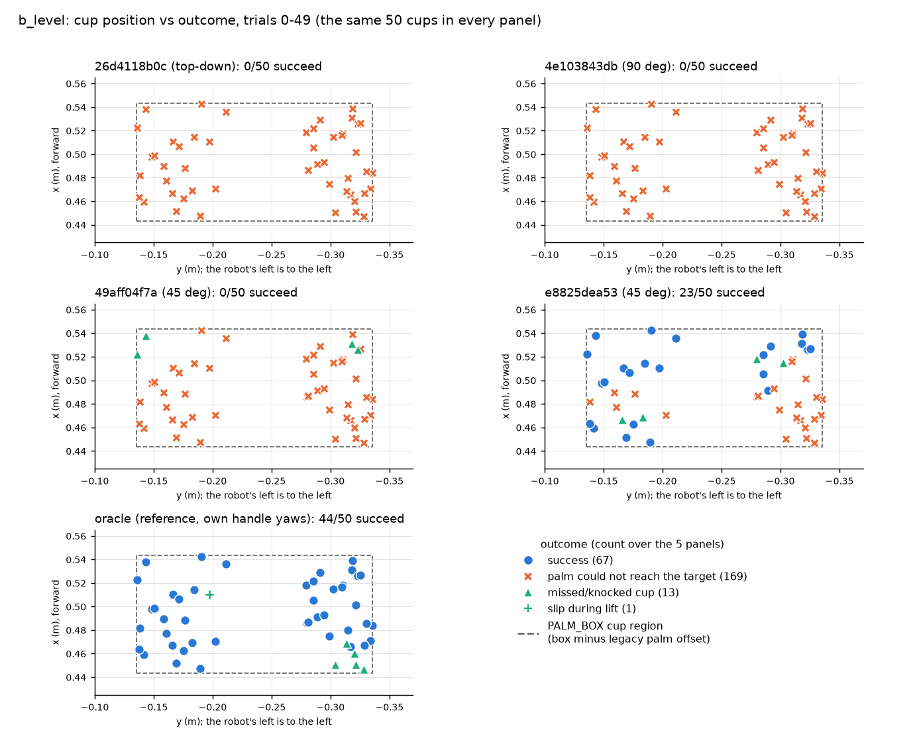
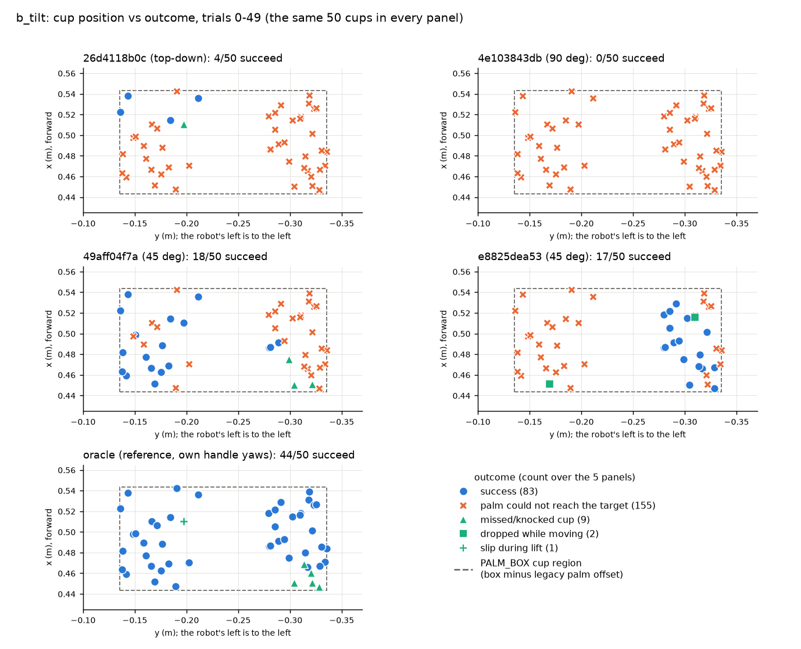
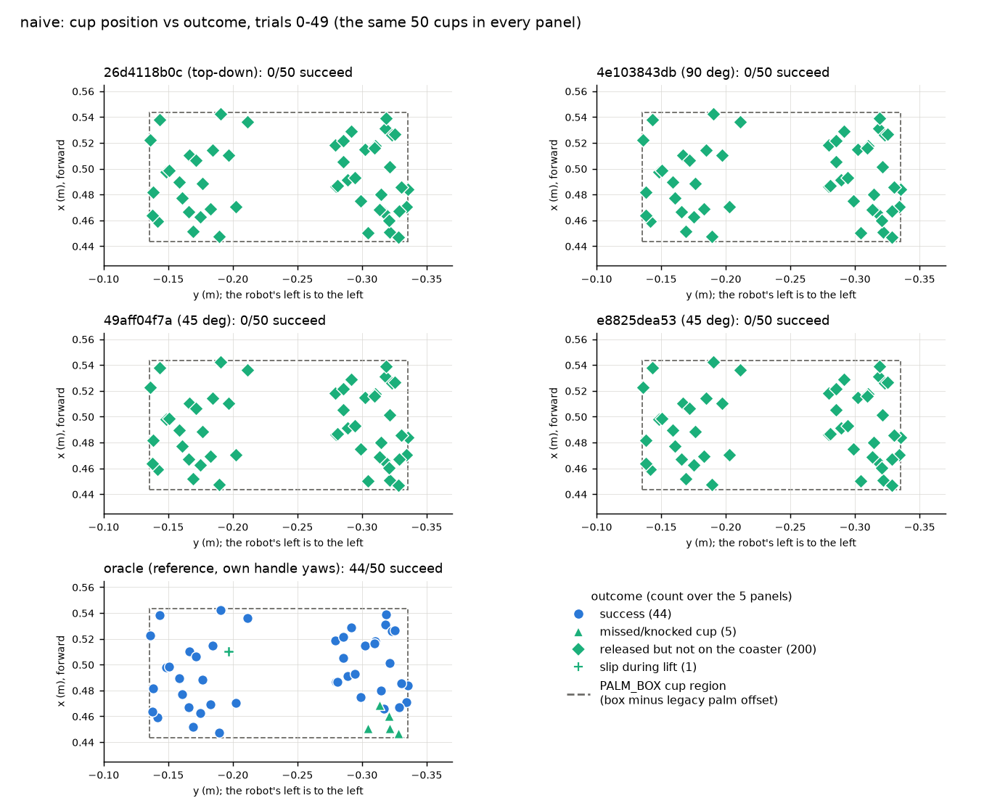

# M4 results: the retargeted paths executed by HERO (mug_v1)

Made by `python -m retarget.m4_summary` from the saved rows (604 row files in results/m4_execute/runs/; the oracle is results/m1_grasp_fix/v3_final/runs/fifty.json, not rerun). Nothing is simulated by this script; every number below is in summary.json.

Variants: **b_level** and **b_tilt** = object-aware paths in four slices with the oracle's settles and grasp checks between them; **naive** = the mapped human path played in one go with its own finger closure, no settle, no grasp check, no place correction. Success is the oracle's own `evaluate()` (cup upright, on the coaster within 5 cm, at rest on it, robot never fell). Failure categories are M1's plus **reach** = `palm could not reach the target` (a failed settle). Layouts: trials 0-49, the same cup and coaster positions for the oracle and every variant.

## Headline (read off the tables below)

- Oracle (Track B final): 44/50, Wilson 95 % 0.762-0.944.
- b_level: 23/200 over the 4 clips, Wilson 95 % 0.078-0.167 (pooled; see caveat 1).
- b_tilt: 39/200 over the 4 clips, Wilson 95 % 0.146-0.255 (pooled; see caveat 1).
- naive: 0/200 over the 4 clips, Wilson 95 % 0.000-0.019 (pooled; see caveat 1).
- Reach failures: 324 of the 400 b trial runs.

## Checks

- Row set: 604/604 rows present, 0 missing, 0 extra, 0 error rows.
- Every row: paths v2 True, profile mug_v1 True, mug mass 0.4 kg True.
- Collision minimum present with the IK mapping check passed: 404/404 b rows; absent as specified on 200/200 naive rows.
- Oracle: fifty.json = trials 0-49 in order, its saved summary equals the recomputed one (44/50); the cup and coaster xy of every variant row equal the oracle's trial row (asserted in the paired table).

## Main table: success over 50 layouts

| run | view | success | Wilson 95 % CI | failures (category n) |
|---|---|---|---|---|
| **oracle (Track B final, mug_v1)** | - | 44/50 | 0.762-0.944 | missed/knocked cup 5, slip during lift 1 |
| 26d4118b0c b_level | top-down | 0/50 | 0.000-0.071 | palm could not reach the target 50 |
| 26d4118b0c b_tilt | top-down | 4/50 | 0.032-0.188 | missed/knocked cup 1, palm could not reach the target 45 |
| 26d4118b0c naive | top-down | 0/50 | 0.000-0.071 | released but not on the coaster 50 |
| 4e103843db b_level | 90 deg | 0/50 | 0.000-0.071 | palm could not reach the target 50 |
| 4e103843db b_tilt | 90 deg | 0/50 | 0.000-0.071 | palm could not reach the target 50 |
| 4e103843db naive | 90 deg | 0/50 | 0.000-0.071 | released but not on the coaster 50 |
| 49aff04f7a b_level | 45 deg | 0/50 | 0.000-0.071 | missed/knocked cup 4, palm could not reach the target 46 |
| 49aff04f7a b_tilt | 45 deg | 18/50 | 0.241-0.499 | missed/knocked cup 3, palm could not reach the target 29 |
| 49aff04f7a naive | 45 deg | 0/50 | 0.000-0.071 | released but not on the coaster 50 |
| e8825dea53 b_level | 45 deg | 23/50 | 0.330-0.596 | missed/knocked cup 4, palm could not reach the target 23 |
| e8825dea53 b_tilt | 45 deg | 17/50 | 0.224-0.478 | dropped while moving 2, palm could not reach the target 31 |
| e8825dea53 naive | 45 deg | 0/50 | 0.000-0.071 | released but not on the coaster 50 |
| **4-clip pool b_level** | - | 23/200 | 0.078-0.167 | missed/knocked cup 8, palm could not reach the target 169 |
| **4-clip pool b_tilt** | - | 39/200 | 0.146-0.255 | dropped while moving 2, missed/knocked cup 4, palm could not reach the target 155 |
| **4-clip pool naive** | - | 0/200 | 0.000-0.019 | released but not on the coaster 200 |

Categories: `palm could not reach the target` = reach (a settle did not converge, see the next table); `missed/knocked cup` = knocked the cup in the approach (every one of them: failed phase approach); `dropped while moving` = the cup slipped in the hand during the transport; `released but not on the coaster` = naive's only failure.

### Which settle gave up (reach failures of the b trial runs)

| clip | variant | settle_pregrasp | settle_grasp | settle_place | total |
|---|---|---|---|---|---|
| 26d4118b0c | b_level | 21 | 29 | 0 | 50 |
| 26d4118b0c | b_tilt | 2 | 40 | 3 | 45 |
| 4e103843db | b_level | 29 | 21 | 0 | 50 |
| 4e103843db | b_tilt | 21 | 28 | 1 | 50 |
| 49aff04f7a | b_level | 0 | 46 | 0 | 46 |
| 49aff04f7a | b_tilt | 0 | 22 | 7 | 29 |
| e8825dea53 | b_level | 0 | 23 | 0 | 23 |
| e8825dea53 | b_tilt | 0 | 31 | 0 | 31 |

## Paired with the oracle (same 50 layouts)

| clip | variant | both succeed | oracle only | variant only | both fail |
|---|---|---|---|---|---|
| 26d4118b0c | b_level | 0 | 44 | 0 | 6 |
| 26d4118b0c | b_tilt | 4 | 40 | 0 | 6 |
| 26d4118b0c | naive | 0 | 44 | 0 | 6 |
| 4e103843db | b_level | 0 | 44 | 0 | 6 |
| 4e103843db | b_tilt | 0 | 44 | 0 | 6 |
| 4e103843db | naive | 0 | 44 | 0 | 6 |
| 49aff04f7a | b_level | 0 | 44 | 0 | 6 |
| 49aff04f7a | b_tilt | 17 | 27 | 1 | 5 |
| 49aff04f7a | naive | 0 | 44 | 0 | 6 |
| e8825dea53 | b_level | 22 | 22 | 1 | 5 |
| e8825dea53 | b_tilt | 14 | 30 | 3 | 3 |
| e8825dea53 | naive | 0 | 44 | 0 | 6 |

Trial numbers of the oracle-only and variant-only cells are in summary.json (`paired`). The oracle's 6 failures are trials 22, 34, 38, 44, 45, 49.

## Collision diagnostic (kinematic, information only, never a gate)

Minimum signed distance (mm; negative = overlap) between the right-hand geoms and the mug (body and handle) over the approach window (from the prelude's end to 1 cm of arc length before G), on M3's single-plan IK clip of each run's path (retarget/collision.py). Trial rows of the 4 clips; `clips` = which clips fill the group. The window stops 1 cm before G, so a late overlap can be the intended grasp contact as well as a knock; the diagnostic cannot tell them apart.

| variant | outcome group | n | min | p25 | median | p75 | max | overlapping (< 0) | clips |
|---|---|---|---|---|---|---|---|---|---|
| b_level | success | 23 | -21.9 | -16.3 | -2.1 | -0.8 | 0.6 | 21 | e8825dea53 23 |
| b_level | approach knock | 8 | -40.0 | -24.0 | -10.9 | -5.8 | -1.8 | 8 | 49aff04f7a 4, e8825dea53 4 |
| b_level | reach (a settle gave up) | 169 | -58.4 | -53.7 | -37.4 | -25.2 | -0.2 | 169 | 26d4118b0c 50, 4e103843db 50, 49aff04f7a 46, e8825dea53 23 |
| b_tilt | success | 39 | -29.8 | -15.9 | -12.3 | -8.6 | -6.1 | 39 | 26d4118b0c 4, 49aff04f7a 18, e8825dea53 17 |
| b_tilt | approach knock | 4 | -28.4 | -28.3 | -27.7 | -27.1 | -26.7 | 4 | 26d4118b0c 1, 49aff04f7a 3 |
| b_tilt | reach (a settle gave up) | 155 | -41.1 | -29.8 | -24.2 | -14.4 | 3.4 | 141 | 26d4118b0c 45, 4e103843db 50, 49aff04f7a 29, e8825dea53 31 |
| b_tilt | other failure (dropped while moving) | 2 | -9.0 | -7.0 | -5.0 | -3.0 | -1.0 | 2 | e8825dea53 2 |
| oracle | success | 10 | 5.2 | 5.5 | 5.6 | 6.0 | 6.1 | 0 | trials 0-9 |

Oracle: the Step 0 rows only (trials 0-9, the oracle's nominal path through the same function); their outcomes in fifty.json: success 10. Its failed trials [22, 34, 38, 44, 45, 49] have no value (not measured). naive: not computed (Step 3 is for b runs).

## Failure maps

Cup xy (sim world, x forward, y to the robot's left) coloured by outcome (blue success, orange reach, aqua any other failure; the marker shape names the failure, see the legend); one panel per clip and the oracle for reference; dashed rectangle = the PALM_BOX cup region (PALM_BOX minus the legacy palm offset [-0.0933, 0.0156]).

### Cluster description (descriptive, found after looking)

Written after looking at the maps and at the counts below; the splits (y < -0.25 m, x >= 0.52 m) were chosen after looking and are not a model. Every number in these sentences is asserted against the rows when this file is written.

- Layout: the 50 cups form two groups in y with an empty band between them (no cup with y between -0.280 and -0.211 m): 28 cups with y < -0.25 ("outer", farther to the robot's right) and 22 nearer its midline ("inner"); 10 cups lie at x >= 0.52 m ("far"). These are properties of the layouts, not of the runs.
- Reach: the 324 reach failures of the b trial runs are failed settles: settle_pregrasp 73, settle_grasp 240, settle_place 11 (the palm was 3.01 to 8.57 cm from the target when the settle gave up).
- b_level, 26d4118b0c and 4e103843db: reach failure at all 50 cups (the whole map is one outcome), and 4e103843db also at all 50 cups for b_tilt.
- b_level, e8825dea53 (the only clip with successes): the 10 far cups all succeeded (10/10); the near cups (x < 0.52) succeeded 13/40, of them 11/18 inner and 2/22 outer.
- b_level, 49aff04f7a: no success; reach failure at 46/50 cups and the other 4 runs are approach knocks, all of them at far cups (4 of 10 far cups).
- b_tilt, e8825dea53: its 17 successes are all in the outer group (17/28 outer cups; 0/22 inner cups).
- b_tilt, 49aff04f7a and 26d4118b0c: the successes are mostly in the inner group (49aff04f7a 15/22 inner vs 3/28 outer; 26d4118b0c 4/22 inner vs 0/28 outer). So the side on which b_tilt succeeds differs between clips.
- Approach knocks, where the cup was hit before the grasp (cup xy of the knocked cups): b_level: 49aff04f7a 4 (cup x 0.522 to 0.538, y -0.323 to -0.136); e8825dea53 4 (cup x 0.467 to 0.518, y -0.302 to -0.166). b_tilt: 26d4118b0c 1 (cup x 0.510, y -0.197); 49aff04f7a 3 (cup x 0.451 to 0.475, y -0.322 to -0.299). No other clip-variant has a knock, and no knock occurs at the close.
- The oracle's own 5 approach knocks (trials 34, 38, 44, 45, 49) all lie in the outer group at the low-x edge (cup x 0.447 to 0.469). In that same corner b_tilt 49aff04f7a knocked the cup at trials 6, 34, 49, of which 34, 49 are also oracle knock trials; the other b knocks are elsewhere.
- b_tilt, e8825dea53 also has 2 'dropped while moving' (the cup slipped in the hand during the transport, trials 1, 32).
- naive: the map has no structure, because all 200 runs fail the same way (released but not on the coaster) at every cup position. The cup ended 9.9 to 21.1 cm (median 13.5) from the coaster centre and had moved 0.0 to 15.6 cm (median 3.0) from its start in xy.

Outcome counts in the four cup regions (S = success; r = reach; K = missed/knocked cup; D = dropped while moving):

| run | outer, x < 0.52 | outer, x >= 0.52 | inner, x < 0.52 | inner, x >= 0.52 |
|---|---|---|---|---|
| 26d4118b0c b_level | r 22 | r 6 | r 18 | r 4 |
| 4e103843db b_level | r 22 | r 6 | r 18 | r 4 |
| 49aff04f7a b_level | r 22 | K 2, r 4 | r 18 | K 2, r 2 |
| e8825dea53 b_level | K 2, r 18, S 2 | S 6 | K 2, r 5, S 11 | S 4 |
| 26d4118b0c b_tilt | r 22 | r 6 | K 1, r 16, S 1 | r 1, S 3 |
| 4e103843db b_tilt | r 22 | r 6 | r 18 | r 4 |
| 49aff04f7a b_tilt | K 3, r 16, S 3 | r 6 | r 6, S 12 | r 1, S 3 |
| e8825dea53 b_tilt | D 1, r 6, S 15 | r 4, S 2 | D 1, r 17 | r 4 |

Region sizes over the 50 cups: outer (y < -0.25) 28, inner 22, far (x >= 0.52) 10.

## Recorded layout v2 (b_level, one run per clip)

Cup at the PALM_BOX centre minus the legacy palm offset minus half my coaster offset; coaster = cup + my offset (both nominal palms centred on the box).

| clip | view | outcome | detail | cup xy | coaster xy | collision min (mm) |
|---|---|---|---|---|---|---|
| 26d4118b0c | top-down | fail: palm could not reach the target | settle_grasp: palm 5.9 cm from the target after 3.0 s (not reachable) | (0.491, -0.163) | (0.495, -0.308) | -30.4 |
| 4e103843db | 90 deg | fail: palm could not reach the target | settle_grasp: palm 6.6 cm from the target after 3.0 s (not reachable) | (0.490, -0.164) | (0.496, -0.307) | -30.1 |
| 49aff04f7a | 45 deg | fail: palm could not reach the target | settle_grasp: palm 4.7 cm from the target after 3.0 s (not reachable) | (0.495, -0.167) | (0.492, -0.304) | -12.6 |
| e8825dea53 | 45 deg | success | cup 0.81 cm from the coaster centre, slip in hand 0.7 cm, rise 12.85 cm, place correction 25.21 mm | (0.506, -0.152) | (0.480, -0.319) | -0.4 |

## Caveats

1. The 4-clip pool's Wilson interval treats its 200 runs as independent. They are not: the 4 clips reuse the same 50 cup and coaster positions, and the clips are 4 separate executions (n = 4), so the real uncertainty is larger than the interval says.
2. Viewpoint and execution vary together (each clip is a different view of a different execution), so a difference between clips cannot be attributed to the viewpoint.
3. The oracle runs the trial's own handle yaw, the variants run the trial's yaw plus (phi_h - phi_ora) for that clip (as in M3). The oracle grasps the body and ignores the handle, so this changes the handle's position only, but it means the paired runs are not identical in every input.
4. The place correction of the b variants uses privileged simulator state, as the oracle's place target does: the cup's true pose in the hand at the transport peak sets the place pose, exactly as the oracle's place target (sim/pick_place.py) does.
5. The oracle's collision values come from 10 runs (trials 0-9) of the oracle's nominal path through M3's harness; they are not a recording from the Track B physics runs, and the oracle's failed trials were not measured.
6. The naive variant replays at a fixed recorded-layout translation (M3), so it ignores where the trial's cup and coaster are by construction.
